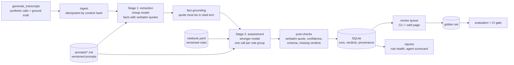

# llm-compliance-judge

An LLM-as-a-judge pipeline that reviews sales-call transcripts against a versioned rulebook. It scores **macro F1 0.89 and Cohen's kappa 0.90 against a 60-call golden set**, and every breach it reports is backed by a verbatim quote or sent to a human.

[](https://github.com/IbramGhali/llm-compliance-judge/actions/workflows/ci.yml) [](LICENSE)

The problem: a compliance team can listen to a small share of sales calls, so most breaches are never seen. An LLM can read every call, but an unchecked judge invents evidence, drifts silently when prompts change, and leaves nobody accountable. This repository shows the design I use to make an LLM judge trustworthy enough to act on. Extraction is separated from judgement, rules and prompts are versioned data, code checks every quote, a human reviews every flag, and a regression gate runs in CI.

> **Synthetic data.** Every transcript, agent and rule is generated by a committed script for a fictional company, Northwind Learning. No real calls or personal data are used.

## At a glance

| | |
| --- | --- |
| Golden set (60 calls x 16 rules) | macro precision 0.921, recall 0.897, **F1 0.891**, **kappa 0.901** |
| Full synthetic set (200 calls) | macro F1 0.890, kappa 0.886 |
| Evidence grounding | 95.0% of 101 quoted breach verdicts had a verbatim quote; the rest were downgraded |
| Cost per transcript (estimate) | 5 LLM calls, ~4,900 input and ~1,060 output tokens, **~$0.030** on `claude-haiku-5-5` (extraction) + `claude-opus-5-5` (assessment) |
| Pipeline overhead | p50 2.4 ms, p95 3.7 ms per transcript with the offline adapter |
| Tests | 53: 35 unit, 13 contract, 5 evaluation, plus 1 live-model test excluded by default |
| Runs on | Windows, macOS, Linux; Python 3.11+; offline by default |

Every number comes from `uv run judge eval` on a fresh clone. The offline numbers use a deterministic fake adapter that behaves like a capable but imperfect model (see [Evaluation](#evaluation) for exactly what that means). The live adapters are optional.

## Demo

One generated call, with the agent's lines shortened:

```text
[0]  agent:    Hi Parker, it's Morgan from Northwind Learning. Thanks for your interest...
[2]  agent:    Can I confirm your full name and date of birth, please?
[7]  agent:    Just so you know, this call is recorded for quality and training purposes.
[10] agent:    Most people pay around $300 a month.
[12] customer: Money's really tight at the moment, I lost my job last month.
[13] agent:    You have a 10-day cooling-off period, during which you can cancel for a full refund.
[16] customer: Yep, sign me up.
[17] agent:    Great, I've processed your enrolment now.
```

What the judge returns for it (all four are true breaches in the ground truth):

| Rule | Verdict | Evidence | Why |
| --- | --- | --- | --- |
| R02 Disclose the total course price | breach | (none: something missing) | Only a monthly amount was given |
| R04 Recording notice at the start | breach | "Just so you know, this call is recorded..." (turn 7) | Came after the agent's first two turns |
| R05 Explain the refund policy | breach | (none: something missing) | No refund explanation before enrolling |
| R15 Respond to financial hardship | breach | "Great, I've processed your enrolment now." (turn 17) | Enrolled after hardship without offering a callback |

`uv run judge serve` opens a reviewer page at http://127.0.0.1:8000 that lists unclear verdicts first, then breaches by confidence. Each item shows the quoted turn and buttons to confirm or dismiss it.

## How it works



1. **Generate.** `scripts/generate_transcripts.py` builds 200 calls from phrase banks with seeded randomness. Breaches are planted on purpose, so the true label of every call and rule is known.
2. **Extract.** One call per transcript to a cheap model returns facts: a label from a fixed list of 20, the turn, and an exact quote. Facts whose quote is not in the cited turn are dropped.
3. **Assess.** One call per rule group (4 groups, 16 rules) to a stronger model returns `pass | breach | unclear` per rule, with an evidence quote, confidence and a short rationale.
4. **Post-check in code.** A breach without a verbatim quote, a verdict below the confidence threshold, a missing verdict or a failed model call all become `unclear`. The model proposes; code decides.
5. **Store with provenance.** Each run records the adapter, both models, both prompt versions and the rulebook version. Each verdict records its rule version.
6. **Review.** A human confirms or dismisses breaches and labels unclear verdicts. `judge review export` writes those decisions into the golden set.
7. **Evaluate and report.** `judge eval` scores the run and `--gate` fails CI on regression. `judge report rules` and `judge report agents` show rule health and per-agent scorecards.

## Key decisions

| Decision | Why | ADR |
| --- | --- | --- |
| Two stages: extraction, then assessment per rule group | Errors become attributable; model cost follows judgement (cheap model for finding, strong model for deciding) | [0001](docs/adr/0001-two-stage-extraction-then-assessment.md) |
| Rules and prompts are versioned files; every verdict records versions | Rule changes are reviewed pull requests, and any verdict can be explained later | [0002](docs/adr/0002-rules-and-prompts-as-versioned-data.md) |
| A breach needs a verbatim quote, or it is downgraded to `unclear` | An invented quote is worse than no flag; grounding becomes a measured metric | [0003](docs/adr/0003-verbatim-evidence-or-downgrade.md) |
| Review decisions become golden-set labels | The evaluation set grows exactly where the judge is weakest | [0004](docs/adr/0004-review-decisions-become-golden-labels.md) |

## Quickstart

Needs [uv](https://docs.astral.sh/uv/). No API key and no network calls by default.

```bash
git clone https://github.com/IbramGhali/llm-compliance-judge && cd llm-compliance-judge
uv sync
uv run judge generate
uv run judge run
uv run judge eval
```

Then try `uv run judge review list`, `uv run judge report rules`, `uv run judge report agents` or `uv run judge serve`.

To use Claude instead of the fake adapter:

```bash
uv sync --extra anthropic
export ANTHROPIC_API_KEY=...          # PowerShell: $env:ANTHROPIC_API_KEY="..."
JUDGE_LLM_PROVIDER=anthropic uv run judge run --limit 10
```

## Configuration

All settings are environment variables (or a local `.env`; see [.env.example](.env.example)).

| Variable | Default | Effect |
| --- | --- | --- |
| `JUDGE_LLM_PROVIDER` | `fake` | `fake` (offline, deterministic), `anthropic` or `openai` |
| `JUDGE_EXTRACTION_MODEL` | `claude-haiku-5-5` | Model for stage 1 |
| `JUDGE_ASSESSMENT_MODEL` | `claude-opus-5-5` | Model for stage 2 |
| `JUDGE_EFFORT` | `medium` | Reasoning effort for the Anthropic adapter |
| `JUDGE_CONFIDENCE_THRESHOLD` | `0.6` | Verdicts below this go to review as `unclear` |
| `JUDGE_FAKE_QUOTE_DRIFT` | `0.03` | Share of quotes the fake adapter paraphrases, to exercise the grounding check |
| `JUDGE_GATE_TOLERANCE` | `0.02` | Allowed drop in golden macro F1 before `--gate` fails |
| `JUDGE_DATA_DIR`, `JUDGE_DB_PATH`, `JUDGE_RULEBOOK` | `data`, `.judge/judge.db`, `config/rulebook.yaml` | Paths |
| `ANTHROPIC_API_KEY`, `OPENAI_API_KEY` | unset | Only for live adapters |

## Evaluation

**What is measured.** Per-rule precision, recall and F1, with macro averages. A breach is the positive class. `unclear` counts as "not flagged" because it goes to a human, and the unclear rate is reported separately so it cannot hide errors. The report also includes:
- Cohen's kappa between the judge and the labels
- the evidence grounding rate
- cost and latency per transcript

**Against what.** Two label sets:
- **Golden set:** 60 calls x 16 rules, committed in `golden/labels.jsonl`. It is chosen so every rule has planted breaches, and 26 of its calls include near-miss wording ("I can't guarantee a job, but..."). Reviewer decisions are merged into it.
- **Full set:** all 200 generated calls, scored against the generator's ground truth.

**Results (golden set):**

| Rule | P | R | F1 | | Rule | P | R | F1 |
| --- | --- | --- | --- | --- | --- | --- | --- | --- |
| R01 identity before fees | 1.00 | 1.00 | 1.00 | | R09 no guaranteed outcomes | 0.50 | 1.00 | 0.67 |
| R02 total price | 1.00 | 1.00 | 1.00 | | R10 no false urgency | 1.00 | 1.00 | 1.00 |
| R03 cooling-off | 0.57 | 1.00 | 0.73 | | R11 no false accreditation | 0.67 | 0.67 | 0.67 |
| R04 recording notice | 1.00 | 1.00 | 1.00 | | R12 no salary promises | 1.00 | 1.00 | 1.00 |
| R05 refund policy | 1.00 | 1.00 | 1.00 | | R13 do not discourage cancelling | 1.00 | 0.67 | 0.80 |
| R06 payment plan terms | 1.00 | 1.00 | 1.00 | | R14 discount limit | 1.00 | 0.56 | 0.71 |
| R07 entry requirements | 1.00 | 1.00 | 1.00 | | R15 financial hardship | 1.00 | 0.80 | 0.89 |
| R08 duration | 1.00 | 1.00 | 1.00 | | R16 consent before enrolment | 1.00 | 0.67 | 0.80 |

**Where it is weak, and why.** Each weakness is a deliberate hard case in the generator:

| Rule | Error | Cause |
| --- | --- | --- |
| R03 | 3 false breaches | The agent said "There's a ten day window to back out at no cost". A real disclosure, but the extractor missed it. |
| R09 | 3 false breaches | "Nobody can promise a guaranteed job outcome" is a near miss. The negation sits too far from "guaranteed" for the extractor's negation window. |
| R11 | 1 false breach | "Some graduates go on to a university degree later" is flagged as an accreditation claim. |
| R14 | 4 missed breaches | "I can knock a quarter off the price" (or "a fifth") states the discount in words, not as a percentage. |
| R15 | 1 missed breach | "Things have been rough since the redundancy" is hardship, but the extractor did not recognise it, so the rule never triggered. |
| R13, R16, R11 | 3 missed breaches | The quote drifted, so the post-check correctly downgraded the verdict to `unclear` for a human. |

These are the cases a prompt or model change should be judged on, and the regression gate protects them.

**What the offline numbers are, and are not.** The fake adapter is deterministic code, not a language model:
- Extraction uses a phrase lexicon with a short negation window. It covers common wording and misses some paraphrases.
- Assessment applies each rule's logic to the extracted facts.
- 3% of evidence quotes are deliberately paraphrased, to exercise the grounding check.

So the offline numbers measure the pipeline (extraction, post-checks, storage, scoring and gating) with a known, imperfect judge. They are not a claim about Claude's accuracy. Running the same evaluation with `JUDGE_LLM_PROVIDER=anthropic` produces live numbers through identical code. Cost per transcript is estimated from prompt sizes and public prices in `config/pricing.yaml`.

**Regression gate.** `judge eval --gate` fails if golden macro F1 falls more than 2 points below `eval/baseline.json` (currently 0.8915). CI runs it on every push.

## Testing

| Tier | Count | What it covers |
| --- | --- | --- |
| Unit | 35 | Rulebook validation, post-checks, scoring maths (P/R/F1, kappa against a known value), generator determinism, fake adapter behaviour, prompt loading |
| Contract | 13 | Provider JSON Schemas match the Pydantic models and the fake output; store idempotency and resume; review-to-golden export; API endpoints and reviewer page |
| Evaluation | 5 | Full offline pipeline on the committed golden set, regression gate, grounding check, kappa floor |
| Live | 1 | One real end-to-end call; runs only with `JUDGE_LIVE_TESTS=1` |

```bash
uv run pytest                     # unit, contract, evaluation
uv run ruff check . && uv run mypy
JUDGE_LIVE_TESTS=1 JUDGE_LLM_PROVIDER=anthropic uv run pytest -m live
```

## Safety and governance

| The model can | The model cannot | Enforced in |
| --- | --- | --- |
| Propose facts and verdicts | Store a breach without a verbatim quote | `pipeline/postchecks.py` |
| Choose labels from a fixed list | Invent labels or rule ids | JSON Schema enums and Pydantic validation |
| Say it is unsure | Hide uncertainty: low confidence becomes `unclear` | `check_verdicts` |
| Fail | Fail silently: errors become `unclear` for every affected rule, and are logged | `failed_verdicts`, `llm_calls` table |
| Flag a call | Take any action on an agent; every flag goes to a human queue | Review queue, `judge review` |

Each run records its provenance (adapter, models, prompt and rulebook versions), so any verdict can be explained later. The fake adapter is the default, so tests and CI never send data to a provider. For live use, transcripts should be redacted of personal details before they leave your network. That step is not included here because the data is synthetic.

## What changes at scale

- **Volume.** Thousands of calls a day means a queue and workers, the provider's batch API for overnight runs (about half the cost), and prompt caching for the stable rulebook and instructions.
- **Store.** Postgres instead of SQLite, with the same schema; runs partitioned by date.
- **Rules.** The rulebook moves into a database with an approval workflow and per-rule effective dates. The validation and versioning in [ADR 0002](docs/adr/0002-rules-and-prompts-as-versioned-data.md) stay the same.
- **Drift.** Rule health becomes an alert. The report already flags a rule whose fire rate moves by 10 points between runs; at scale that goes to a channel with the rule owner tagged.
- **Calibration.** With enough reviewed labels, map raw confidence to observed precision per rule, and route only the uncertain band to humans.
- **Speech.** Real calls add speech-to-text and speaker diarisation upstream. Transcript quality then becomes its own evaluated stage.

## Known limitations and roadmap

- Offline numbers come from a deterministic stand-in, not a model. Live evaluation numbers are the next item.
- Extraction misses facts stated in unusual wording (R03, R14 above). A second-pass "re-read for missing disclosures" step is a candidate fix, and the gate would measure it.
- One reviewer per decision. A second-reviewer step for disputed labels is planned.
- No authentication on the API or reviewer page. It is a local demo.
- Single-language, single-channel transcripts.

## Layout

```text
config/          rulebook.yaml (versioned rules), pricing.yaml
prompts/         extraction.v1.md, assessment.v1.md
golden/          labels.jsonl (committed golden set)
eval/            baseline.json (regression gate)
scripts/         generate_transcripts.py
src/compliance_judge/
  synth.py       synthetic call generator and ground truth
  llm/           LLMClient interface, fake, anthropic and openai adapters, JSON Schemas
  pipeline/      runner (two stages) and post-checks
  store.py       SQLite with provenance and idempotent writes
  evaluation.py  metrics, grounding, cost, regression gate
  review.py      review decisions and golden-set export
  reports.py     rule health and agent scorecard
  api.py         FastAPI endpoints and reviewer page
  cli.py         `judge` command
tests/           unit, contract, evaluation, live
docs/adr/        architecture decision records
```

## AI assistance disclosure

Built with Claude Code as a pair programmer. I set the design, the decisions recorded in the ADRs and the evaluation approach, and I reviewed the code and checked every result.
